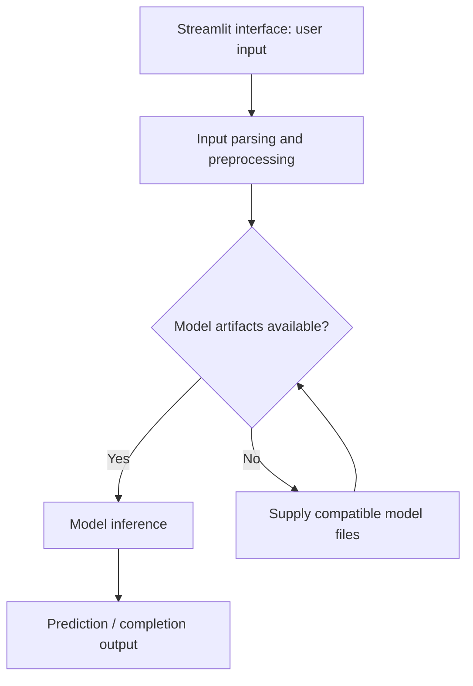

# CodePilot — Python Code Completion

Python code-completion experiment with a training notebook, a Transformers inference module, and a Streamlit interface. Compatible model weights must be supplied separately.

## Project focus

Machine-learning experiment. Use the directory map to choose a focused example or learning topic instead of treating the repository as one application.

## Workflow



## Repository structure

| Path | Purpose |
| --- | --- |
| [`CodeAutocomplete_Colab.ipynb`](CodeAutocomplete_Colab.ipynb) | Interactive notebook; inspect its data and dependency setup before execution. |
| [`app/`](app) | Application source; inspect this directory for the framework-specific implementation. |
| [`logs/`](logs) | Recorded experiment or application logs. |
| [`requirements.txt`](requirements.txt) | Python dependency manifest. |
| [`src/`](src) | Application or exercise source code. |

## Getting started

```bash
git clone https://github.com/Raimal-Raja/Autocode_completion_tool_deeplearning.git
cd Autocode_completion_tool_deeplearning
```

```bash
python -m venv .venv
source .venv/bin/activate
```

On Windows PowerShell, activate the environment with `.venv\Scripts\Activate.ps1` instead.

```bash
python -m pip install -r requirements.txt
```

Supply the model/tokenizer files expected by `src/inference.py` before opening the UI. The current tracked tree does not include the advertised fine-tuned model directory.

```bash
python -m streamlit run app/streamlit_app.py
```

## Configuration and scope

Training and inference require compatible external model weights and tokenizer files. Installing dependencies alone does not provide a trained model. Review generated code before using it.

## Verification

Use the setup commands and inspect the selected interface, example, or notebook with known inputs. This documentation review checks repository paths and dependency declarations; it does not claim fresh end-to-end execution or model-quality measurements.

## Contributing

Include reproduction steps, the affected path, expected behavior, and the checks you ran. Keep credentials, generated environments, and unnecessary build artifacts out of commits.

## License

No top-level license file is currently tracked. Check reuse permissions with the repository owner.
